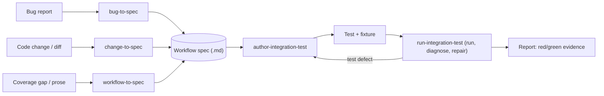

# Agent-Driven Integration Testing

**Status:** Draft proposal · **Author:** Cory Radcliff · **Last updated:** 2026-11-05

---

## 1. Summary

We propose a small family of agent skills that turn a **workflow description**
(prose, a bug report, or a code change) into a checked-in **workflow spec**, then
into a runnable IDE integration test that is executed, diagnosed, and reported on
with reproducible evidence. Agents use these skills to (a) verify their own code
changes in a real IDE, (b) reproduce bugs and validate fixes, and (c) close
integration-coverage gaps.

## 2. Motivation

- Unit tests (`testSrc/unit`) can't catch many of this plugin's real failures:
  UI wiring, EDT/threading problems, real Flutter SDK interactions, tool windows,
  and run/debug flows.
- The Starter-based suite in `testSrc/integration` is
  [explicitly experimental](../../testSrc/integration/README.md): it's brittle,
  depends on the environment, hard-codes IDE builds in `Setup.kt`, and doesn't
  run in CI. The harness pieces this design builds on already exist:
  `ExistingProjectUITest` (open a project, wait for indexing, select a device,
  read the console), `utils/Platform.kt` (cross-platform paths), and the
  experimental [`record-test-walkthrough`](../skills/record-test-walkthrough/SKILL.md)
  skill (records any UI test as a step-by-step screenshot walkthrough).
- Agents already change plugin code. Without a way to exercise those changes in
  an IDE, the verification work falls back on the maintainers.
- Bug triage is slow because reproducing a bug is manual. A failing test that
  reproduces the bug is the most useful artifact for both the fix and the review.

## 3. Goals and Non-goals

**Goals**
- An agent can go from bug, change, or prose to a spec, then to a test, then to red/green evidence, without
  human help for typical workflows.
- Generated tests are readable, deterministic (condition-based waits), and
  maintainable. The spec captures intent so a test can be regenerated when the UI
  changes.
- Linux first, with a design that also runs on macOS and Windows.

**Non-goals**
- Recording a human's IDE session as input. Inputs are prose, bugs, and code
  changes only. "Playback" means running generated tests, which
  `record-test-walkthrough` can record for review.
- Replacing unit tests. Integration tests are reserved for behavior that needs a
  real IDE.
- CI integration in the first phases (see Rollout).
- Remote Development (WSL/SSH/Dev Containers). This matches the
  [SDK design doc](sdk-functionality.md).

## 4. Design

### 4.1 Skill map

Two **core** skills do the heavy lifting. Thin **entry-point** skills only
produce specs. The workflow spec is the contract between them.

| Skill | Input | Output |
|---|---|---|
| `workflow-to-spec` | Prose description of a user workflow, or a coverage gap | Spec |
| `bug-to-spec` | GitHub issue / bug text | Spec whose oracle encodes the *correct* behavior |
| `change-to-spec` | Local diff / branch | Spec(s) that exercise the changed behavior |
| `author-integration-test` | Spec | Test class (+ fixture overlay if needed) at the right test level |
| `run-integration-test` | Test(s), mode (`repro` / `validate` / `check`) | Classified results, repairs, evidence report |

**Relationship to `record-test-walkthrough`:** that skill already includes a
"Writing a new UI test" guide and records test runs as walkthroughs. The
authoring guidance moves into `author-integration-test`, and
`record-test-walkthrough` stays focused on recording. `run-integration-test`
calls it to capture per-step screenshots as evidence on Linux.

### 4.2 Workflow spec format

The spec is structured markdown, checked in at
`testSrc/integration/specs/<name>.md` and linked from the test's KDoc. It has
these fixed sections:

- **Title / Source:** the issue link, PR, or "manual".
- **Fixture:** the base project (`flutter create` options), an optional overlay
  name from `testData/integration/overlays/`, and the IDE product (IU / IC /
  Android Studio).
- **Preconditions:** SDK state, settings, and open files.
- **Steps:** user-level actions, numbered (for example "Open `lib/main.dart`",
  "Invoke *Flutter Hot Reload*").
- **Expected outcome:** the observable result.
- **Oracle:** how to assert it: UI text or state, a log line, a file's contents,
  or a service state. This is what red/green is judged against.
- **Test level:** `ui` (Starter + Driver) or `platform` (fixture test). See 4.3.

### 4.3 Framework and test level

- **UI level:** JetBrains IDE Starter + Driver, which the existing suite already
  uses.
- **Platform level:** if the oracle doesn't need real UI, the authoring skill
  **must** drop down to `BasePlatformTestCase` or a heavy fixture test in
  `testSrc/unit`. These tests are cheaper and less flaky.
- **Target IDE:** IntelliJ IDEA Ultimate (`IU`) at `latest` is the default.
  That matches `setupTestContextIU262`, and since 2025.3 JetBrains ships one
  IntelliJ IDEA distribution instead of a separate Community edition. The same
  tests must also run on Android Studio. The IDE is chosen at run time instead
  of being hard-coded in `Setup.kt`:
  - `ide.product`: `IU` (default), `AI` (Android Studio), or `IC` (only for
    builds before 2025.3).
  - `ide.version`: `latest` (default; the newest stable release of that
    product) or a specific build number or version the user provides.
  - Both are passed as Gradle properties (for example
    `./gradlew integration -Pide.product=AI -Pide.version=2026.1.2.8`) and
    forwarded to the test JVM as system properties.
- Tests must not assume a product. Product-specific behavior (for example
  Android Studio's own device selector) is guarded with an explicit
  `assumeProduct(...)` and noted in the spec's **Fixture** section.

### 4.4 Locator discovery

Agents can't see the IDE, so they find UI elements in this order:

1. **Prefer actions and services over clicks:** invoke action IDs or query
   plugin services through Driver wherever possible.
2. **Probe run:** when UI interaction is unavoidable, run an exploratory probe
   test that dumps the Swing component tree and a screenshot at each step. The
   agent writes locators from that output.
3. **Source and naming:** read plugin source for component names. Where our
   components lack a stable `name`/`accessibleName`, add one. This also helps
   accessibility.

### 4.5 Fixtures

The base project is created at test time with `flutter create`, as
`ExistingProjectUITest` already does, so it always matches the SDK under test.
Scenario-specific changes are **named overlays** checked in at
`testData/integration/overlays/<name>/` (for example `invalid-sdk-path`,
`non-ascii-test-names`, or `two-sdks`). An overlay is a set of files copied
over the base project before the IDE opens it, applied in a
`prepareProject()` override. Specs refer to overlays by name. The authoring
skill adds a new overlay only when none of the existing ones fit.

### 4.6 Execution environment

- The `run-integration-test` skill starts with a **preflight** check: Flutter
  SDK (`FLUTTER_SDK` or the CI-pinned version), a display (Xvfb when headless),
  disk space, and the IDE cache. If anything is missing, it fails fast with an
  actionable message.
- Linux is the reference platform. macOS and Windows are supported by
  avoiding OS-specific paths and shortcuts, which `utils/Platform.kt` already
  centralizes. They get validated in P3. Walkthrough recording stays
  Linux-only.

### 4.7 Red/green protocol

| Mode | Pass criterion |
|---|---|
| `repro` | The test fails on unfixed code **for the expected reason** (the failure matches the oracle, not a timeout or locator error), **N = 3** consecutive times |
| `validate` | The same test passes on the fix N = 3 consecutive times |
| `check` | The test passes N = 3 times. Used for change verification and coverage |

N starts at 3. A mixed result (for example 2 passes and 1 failure) counts as
**flaky**. Flaky tests fail the run and are reported, not quarantined.

**Hangs and deadlocks:** a bare timeout is never an acceptable "expected
reason". For freeze bugs, the test captures a thread dump on timeout, and the
oracle names the blocking frame (for example the EDT parked in
`FlutterModuleUtils.setFlutterModuleWithoutReload`).

Every run records logs, screenshots, the failure reason, and wall-clock time in
the report.

### 4.8 Diagnosis and repair policy

The skill classifies each failure into one of three buckets:

- **Environment** (SDK, display, download): report it and don't repair.
- **Test defect** (locator, timing, wrong step): repair it automatically, with
  a budget of **3 iterations or about 45 minutes**.
- **Product behavior:** this is a real finding. Report it, or in `repro` mode
  count it as a success.

Hard rules: the agent never weakens an oracle, and never adds fixed sleeps,
because waits must be condition-based. When the budget runs out, it escalates to
the user with the evidence.

### 4.9 Autonomy limits

- Agents may write files, run tests, and **commit to a local branch**. They must
  **never push**, open PRs, or comment on issues.
- Generated tests carry `@Tag("agent-generated")` until a human reviews them.
- Every session ends with a report covering the spec, test, fixture, evidence,
  and suggested commit message, plus any changes that need close review.

## 5. Rollout and Metrics

| Phase | Scope | Exit criteria |
|---|---|---|
| **P0** | Harden the existing suite: IDE product/version selection (4.3), preflight, overlays, condition waits | The existing integration tests pass 5/5 locally on IU `latest` |
| **P1** | `author-integration-test` + `run-integration-test` | 3 hand-written specs become passing tests with no manual edits to the test code |
| **P2** | `bug-to-spec` + `repro`/`validate` modes | On the benchmark below, the agent reproduces ≥ 3 of 5 without help |
| **P3** | `change-to-spec`, `workflow-to-spec`, Android Studio validation, macOS/Windows, CI | TBD at the end of P2 |

**Metrics:** repro success rate, flake rate (failures on reruns that should
pass), human edits per generated test, and wall-clock time per spec-to-green
cycle.

### 5.1 P2 benchmark issues

These are closed bugs with clear steps, a deterministic oracle, no physical
device, and a fix merged in 2026, so that undoing the fix on current code is
practical. They're run as described in 5.2.

| Issue | Behavior | Fix commit(s) | Test level | Notes |
|---|---|---|---|---|
| [#9106](https://github.com/flutter/flutter-intellij/issues/9106) | The New Project wizard shows an empty Flutter SDK dropdown after starting on another language and canceling | `562ab2b59` | ui | Pure UI with exact steps. The easiest starting point |
| [#8845](https://github.com/flutter/flutter-intellij/issues/8845) | Opening a Flutter project with no `.idea/` in IntelliJ IDEA silently does nothing | `4681015cd`, `e965bb8d9` | ui | IntelliJ-specific. Oracle: a project window opens with a Flutter module |
| [#7985](https://github.com/flutter/flutter-intellij/issues/7985) | Test names in Cyrillic or Korean are escaped in run configurations, so the tests don't run | `dc2db7f6d` | platform | Exercises the "drop to platform level" rule |
| [#9093](https://github.com/flutter/flutter-intellij/issues/9093) | The IDE deadlocks on project open when the Flutter SDK path is invalid | `13507d815` | ui | Exercises the thread-dump oracle (4.7). Reported on Windows, so Linux repro is unconfirmed |
| [#9013](https://github.com/flutter/flutter-intellij/issues/9013) | The IDE freezes when you apply a Flutter SDK path change in Settings | `75eb6ab6c`, `c66073335` | ui | Needs the `two-sdks` overlay. May be timing-sensitive |

**Alternates** (these need a running app on the Linux desktop device):
[#8795](https://github.com/flutter/flutter-intellij/issues/8795) (device label
missing from run tabs, `be8bcce89`) and
[#8890](https://github.com/flutter/flutter-intellij/issues/8890) (Debug tool
window shown instead of Run in 2026.1, `d60ef029c`).

**Stretch case (not scored):**
[#9176](https://github.com/flutter/flutter-intellij/issues/9176), Dart code
completion stops working. This issue is open, and the known cause is the
Flutter Enhancement Suite (FES) plugin hooking into the Dart plugin's
completion extension point (dart-intellij-third-party#735, fix in
dart-intellij-third-party#814).
- **Setup:** the spec pins the FES and IDE versions, and the test installs FES
  the same way `Setup.kt` installs Dart.
- **Oracle:** typing `Contai` in `lib/main.dart` offers `Container`, and for
  red, the FES exception appears in `idea.log`.
- **Validation:** green uses a Dart plugin build that includes #814, loaded
  through `DART_PLUGIN_ZIP`.
- **Why it isn't scored:** the fix lives outside this repo, and one reporter
  saw the problem without FES installed, from a cause that's still unexplained.
  The issue still covers two cases the scored set doesn't: a fix in another
  plugin, and the `ide.product=AI` path.

### 5.2 Closed vs. open issues

**Closed issues** have a known fix, so they're used to measure the agent:

1. **Hide the answer.** The agent sees only the issue text as originally filed.
   It doesn't see the fix PR, the fix diff, or comments posted after the fix.
   Only the runner knows the fix commit, so the test can't be shaped around
   the fix code.
2. **Undo the fix on current code.** The harness doesn't exist at old commits,
   and old commits may not build against today's IDE. So:
   - **Default:** check out `main`, reverse-apply the fix diff, and run `repro`
     (expect red). Then restore the fix and run `validate` (expect green).
   - **Fallback**, if the revert conflicts with later changes: check out the
     fix commit's parent and copy in today's `testSrc/integration` folder.
   - **If neither builds,** the issue is marked "unbuildable" and doesn't count
     against the agent.
3. **Pin the IDE version from the issue.** When a bug is tied to an IDE
   version (for example #8890 on 2026.1, or #8795 on 2025.3 and newer), the
   spec sets `ide.version` instead of `latest`.
4. **Grade.** The test must be red with the fix undone and green with it
   restored, both for the expected reason. A human then confirms the test
   asserts the behavior the issue describes. Passing tests can be kept as
   regression tests.

**Open issues** have no known answer, which is the real use case:

- **Red is the result:** the test fails on current `main` for the expected
  reason.
- **"Didn't reproduce" is a report, not a verdict.** The agent lists the
  environments, versions, and overlays it tried, and how confident it is,
  because a miss could come from the environment, the version, or missing
  details in the report.
- **Green waits for a candidate fix:** the agent's own, a PR, or another plugin
  build (for example `DART_PLUGIN_ZIP`).
- **No comments on the issue** (4.9). Findings go to the user.

## 6. Risks

- **Starter/Driver API churn.** Mitigation: a step helper library (open question 1)
  so that a churn fix touches one place.
- **Slow runs** (IDE download and startup take minutes). Mitigation: cache IDE
  builds under `build/`, choose the platform level when possible, and batch
  probe steps.
- **Agents "fixing" tests by weakening them.** Mitigation: the hard rules in
  4.8, oracles checked in as part of the spec, and human review via the tag.
- **Flaky environments being misread as product bugs.** Mitigation: the
  preflight check plus the "expected reason" check in `repro` mode.
- **Old fix commits that no longer build.** Mitigation: the benchmark only uses
  2026 fixes, which are undone on current `main` (5.2), and unbuildable issues
  don't count as misses.
- **Leaking the answer on closed issues.** Mitigation: the agent sees only the
  issue text as originally filed, and only the runner knows the fix (5.2).

## 7. Open Questions

1. **Step helper library: design it up front in P0, or let it grow out of P1?**
   This is a small Kotlin library that wraps raw Starter/Driver calls in
   plugin-level steps, such as `applyOverlay("invalid-sdk-path")`,
   `invokeAction("Flutter.HotReload")`, `openFlutterSettings()`, or
   `waitForToolWindow("Flutter Inspector")`. The authoring skill writes tests
   against these steps instead of raw locators, so tests stay short and a UI or
   API change is fixed in one place. `ExistingProjectUITest` already provides
   the first steps (`openProjectFile`, `selectDevice`, `waitForConsoleText`,
   `stopApp`, `step`). The question is whether to grow that base class or
   pull the steps into `utils/`.

### Resolved

- **Default IDE:** IntelliJ IDEA (IU) at `latest`, with Android Studio and any
  user-given version supported (4.3).
- **Fixtures:** `flutter create` plus named checked-in overlays (4.5).
- **N:** 3 runs, and flaky results fail the run (4.7).
- **Benchmark:** see 5.1.
