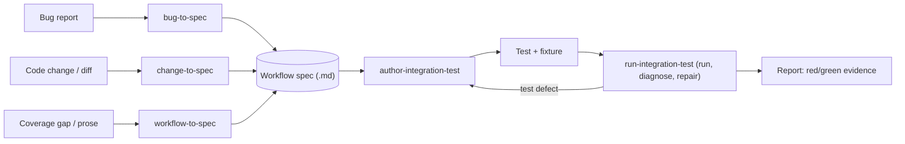

# Agent-Driven Integration Testing

**Status:** Draft proposal · **Author:** Cory Radcliff · **Last updated:** 2026-11-05

---

## 1. Objective

To explore the design and implementation of agent skills and related scripts
to help agents drive testing. The goal is to have an end to end system that a
human can specify a particular process within the IntelliJ plugins (Flutter
first) to test, and an agent can write a test that is valid and worthwhile.

The alignment sought by this document:

- The proposed process is clear and straightforward.
- The proposed process has value to the project.
- Tests will be valuable, ensuring that they can test important things and
  catch problems reliably.
- Success is clear: the most important thing is tests that are valuable, and
  that we can create and update these easily with well defined agent skills to
  help manage a potentially large number of tests.

## 2. Summary

We propose a small family of agent skills that turn a **workflow description**
(which is a description of a set of developer interactions with the IDE that
has a particular purpose in being tested, whether a bug, a validation or a new
feature) into a checked-in **workflow spec**, then
into a runnable IDE integration test that is executed, diagnosed, and reported on
with reproducible evidence. Agents use these skills to (a) verify their own code
changes in a real IDE, (b) reproduce bugs and validate fixes, and (c) close
integration-coverage gaps.

### 2.1 Definition of terms

| Term | Meaning in this doc |
|---|---|
| **Workflow** | One user **Goal** (the outcome the user wants) reached through ordered **Tasks**, each made of user **Interactions** (clicks, typing, menu picks). For example: Goal "see an edit in the running app", Tasks *Launch*, *Edit*, *Reload*, Interactions "pick Chrome in the device selector", "click Run", "click Flutter Hot Reload". This is the Goal / Task / Interaction model used for critical user journeys; workflows are the unit this design tests (5.2). |
| **Workflow spec** | The checked-in markdown contract (5.2) that describes one workflow: fixture, preconditions, steps, expected outcome, and oracle. The entry-point skills produce it; `author-integration-test` consumes it. |
| **Oracle** | How a test decides pass or fail: the concrete observations it makes (UI state, console text, file contents, a service's state, a log line). Red/green (5.7) is judged against the oracle, so a weak oracle means a weak test. |
| **Seam** | The place where the plugin's code (`io.flutter.*`) meets something it doesn't own: the IDE platform, the Dart plugin, the `flutter` process, the VM service, a Swing or JCEF surface. It's the boundary a test can observe or break at. A spec's **Target seam** names the `io.flutter` class, action ID, or `plugin.xml` registration whose breakage must turn the test red; it answers "what plugin behavior is this test about?" and gives the red phase something specific to break. The **seam gate** picks the test level from the smallest runtime the target seam needs to exist (unit, `platform`, or `ui`), not from how the oracle is worded, so an agent can't choose a level by rephrasing the assertion. |
| **Fixture** | The project and IDE state a test starts from. At the UI level it's a project generated at test time by `flutter create`, optionally modified by an overlay, opened in the chosen IDE product. At the platform level, "fixture" is also IntelliJ's own term: a test fixture (`IdeaProjectTestFixture`, `CodeInsightTestFixture`) that builds a headless project inside the test JVM. A **heavy fixture test** in this doc means a platform-level test built on `HeavyIdeaTestFixture` / `HeavyPlatformTestCase`: a real project directory on disk with real modules, SDK entries, and VFS, created per test. It's what we reach for when the behavior depends on a Flutter module or SDK being configured (for example run configurations in #7985) but still doesn't need a visible IDE. See the light / heavy row below. |
| **Overlay** | A named directory under `testData/integration/overlays/<name>/` whose files are copied over the generated project before the IDE opens it (5.5). Overlays put the project into a scenario-specific state (`invalid-sdk-path`, `two-sdks`, `non-ascii-test-names`) without checking in whole projects that go stale. Overlays change the project under test, never the plugin. |
| **IDE Starter** | JetBrains' `intellij-ide-starter` test framework. From the test JVM it downloads an IDE build and plugins into a sandbox, prepares a project, launches the IDE as a separate process, and collects its logs and screenshots. The existing `testSrc/integration` suite is built on it. |
| **Driver** | JetBrains' remote-call API (`intellij.driver`) that the test JVM uses to reach into the running IDE: call services and actions through `@Remote` interfaces, and find and operate Swing components through locators. Driver sees Swing. For embedded web views (JCEF) it sees only the browser component, so page content must be checked by running JavaScript in the browser (`JBCefJSQuery`) rather than through a locator. |
| **Locator** | The expression Driver uses to find a UI component: an XPath-like query over the Swing component tree by class, `name`, `accessibleName`, or visible text (for example `//div[@class='ActionButton' and @myicon='hotReload.svg']`). Locators are the most brittle part of a UI test, which is why 5.4 prefers action IDs and services. |
| **Probe run** | A throwaway exploratory test the agent runs when a step needs UI it hasn't seen (a wizard, a combo box, a dialog button). Agents can't see the IDE, so the probe performs the steps it already knows (open project, select device, run) and at each unknown step uses Driver to dump the live Swing component tree (one entry per component with `class`, `name`, `accessiblename`, `text`, `myaction`, `myicon`, `enabled`) and take a screenshot. The agent reads the dump to write locators (for example `//div[@myaction='Flutter Hot Reload']`), or notices the action ID and invokes that instead, then discards the probe; nothing from it is checked in. Because every probe is a full IDE boot, all unknown steps go into one run, after reading `plugin.xml` and `src/` for component names first (5.4). It uses the same per-step capture as `record-test-walkthrough`. Like Driver, it shows a `JBCefBrowser` component for DevTools but nothing inside it. |
| **Test level** | Where a test runs. **UI level:** a real IDE process driven by Starter + Driver; minutes per run. **Platform level:** IntelliJ's in-process test fixtures in `testSrc/unit` (below); seconds per run, no IDE window. |
| **Light / heavy fixture test** | IntelliJ's own test infrastructure for platform-level tests. A **light** test (`BasePlatformTestCase`) reuses one in-memory project across tests and is fastest. A **heavy** test (`HeavyPlatformTestCase`) creates a real project directory with real modules, SDKs, and VFS per test; slower, but needed when the behavior depends on module or SDK wiring. Both run headless in the test JVM with no IDE window or Starter download, which is why 5.3 calls them cheaper and less flaky. |
| **Unified distribution** | Since 2025.3, JetBrains ships one IntelliJ IDEA installer instead of separate Community (`IC`) and Ultimate (`IU`) downloads. The free tier and the paid features are in the same build, unlocked by license. IDE Starter still identifies it by product code `IU`, so `IC` only applies to builds before 2025.3 (5.3). |
| **Red / green** | A test is **red** when it fails on code that has the bug and **green** when it passes on code with the fix. A test that has only ever been green proves nothing about what it catches, so 5.7 requires both, for the expected reason. |
| **Modes (`repro` / `validate` / `check`)** | What `run-integration-test` is asked to prove (5.7): `repro` expects red on unfixed code, `validate` expects green on the fix, `check` expects green for change verification or coverage. |
| **Walkthrough** | A step-by-step screenshot record of a UI test run, produced by the `record-test-walkthrough` skill (Linux only). Used as review evidence, not as test input. |
| **JCEF / JxBrowser** | The embedded Chromium that renders DevTools pages (Inspector, Performance) inside the IDE. JCEF ships with the JetBrains Runtime; JxBrowser is the licensed alternative the plugin can use instead. Tests that touch these views need one of them working, and must check page content, not just that a browser component exists. |
| **EDT** | The Event Dispatch Thread, Swing's single UI thread. Blocking it freezes the IDE, which is the failure mode behind the deadlock issues in 6.1 and why 5.7 needs a thread-dump oracle. |

## 3. Motivation

- Unit tests (`testSrc/unit`) can't catch many of this plugin's real failures:
  UI wiring, EDT/threading problems, real Flutter SDK interactions, tool windows,
  and run/debug flows.
- The Starter-based suite in `testSrc/integration` is
  [explicitly experimental](../../testSrc/integration/README.md): it's brittle,
  depends on the environment, hard-codes IDE builds in `Setup.kt`, and doesn't
  run in CI. [#9209](https://github.com/flutter/flutter-intellij/pull/9209)
  adds the harness pieces this design builds on, and the rest of this doc
  refers to them by name: `ExistingProjectUITest` (open a project, wait for
  indexing, select a device, read the console), `utils/Platform.kt`
  (cross-platform paths), the `DART_PLUGIN_ZIP` override in `Setup.kt`, and
  the experimental `record-test-walkthrough` skill (records any UI test as a
  step-by-step screenshot walkthrough).
- Agents already change plugin code. Without a way to exercise those changes in
  an IDE, the verification work falls back on the maintainers.
- Bug triage is slow because reproducing a bug is manual. A failing test that
  reproduces the bug is the most useful artifact for both the fix and the review.

## 4. Goals and Non-goals

**Goals**
- An agent can go from bug, change, or prose to a spec, then to a test, then to
  red/green evidence, without human help for typical workflows. Examples:
  - Creating a new Flutter application with the plugin, and verifying that the
    new project opens and has the `main.dart` file open. This would allow us to
    check that the plugin functions properly and doesn't hang or crash on
    creating a new project (something that has been broken in the past).
  - Typing invalid Dart code into a source file, and ensuring that the plugin
    shows the correct UI for informing the user of their mistake. This would
    allow us to test changes in integrations with the Analysis Server (the LSP
    migration, for instance).
- Generated tests are readable, deterministic (condition-based waits), and
  maintainable. The spec captures intent so a test can be regenerated when the UI
  changes.
- Linux first, with a design that also runs on macOS and Windows.
- We can have a meaningful number of tests that help us more safely take on
  refactorings, more confidently test releases, and accept more external
  contributions.

**Non-goals**
- Recording a human's IDE session as input. Inputs are prose, bugs, and code
  changes only. "Playback" means running generated tests, which
  `record-test-walkthrough` can record for review.
- Replacing unit tests. Integration tests are reserved for behavior that needs a
  real IDE.
- CI integration in the first phases (see Rollout).
- Remote Development (WSL/SSH/Dev Containers). This matches the
  [SDK design doc](sdk-functionality.md).

## 5. Design

### 5.1 Skill map

Two **core** skills do the heavy lifting. Thin **entry-point** skills only
produce specs. The workflow spec is the contract between them.

| Skill | Input | Output |
|---|---|---|
| `agent-testing-workflow-to-spec` | Prose description of a user workflow, or a coverage gap | Spec |
| `agent-testing-bug-to-spec` | GitHub issue / bug text | Spec whose oracle encodes the *correct* behavior |
| `agent-testing-change-to-spec` | Local diff / branch | Spec(s) that exercise the changed behavior |
| `agent-testing-author-integration-test` | Spec | Test class (+ fixture overlay if needed) at the right test level |
| `agent-testing-run-integration-test` | Test(s), mode (`repro` / `validate` / `check`) | Classified results, repairs, evidence report |

**Relationship to `record-test-walkthrough`:** that skill already includes a
"Writing a new UI test" guide and records test runs as walkthroughs. The
authoring guidance moves into `author-integration-test`, and
`record-test-walkthrough` stays focused on recording. `run-integration-test`
calls it to capture per-step screenshots as evidence on Linux.

### 5.2 Workflow spec format

A **workflow** is one user **Goal** (the outcome the user wants), reached
through ordered **Tasks**, each made of user **Interactions** (clicks, typing,
menu picks). This is the Goal / Task / Interaction model used for critical
user journeys, with one difference: our steps are ordered, because a test has
to run them in sequence.

The spec is structured markdown, checked in at
`testSrc/integration/specs/<name>.md`, linked from the test's KDoc, and listed
in the catalog (below). It has these fixed sections:

- **Title / Goal / Source:** the Goal in one sentence, and the issue link, PR,
  or "manual".
- **Fixture:** the base project (`flutter create` options), an optional overlay
  name from `testData/integration/overlays/`, and the IDE product (`IU` /
  `IC` / Android Studio, as in 5.3).
- **Preconditions:** SDK state, settings, and open files.
- **Steps:** a table, one row per user interaction, in order, grouped by Task.
  The **User interaction** column is what a person does, in the words of the
  UI. The **Drives** column is the technical action the test performs for it:
  an action ID, a helper from the step library, or a locator. The spec reads
  from the first three columns alone; the fourth is what keeps the test
  honest.

  | # | Task | User interaction | Drives |
  |---|---|---|---|
  | 1 | Launch | Pick *Chrome (web)* in the device selector on the main toolbar | `selectDevice("Chrome")` |
  | 2 | Launch | Click *Run* next to the `main.dart` configuration | `invokeAction("Run")` on the `main.dart` configuration |
  | 3 | Edit | In `lib/main.dart`, change `'Flutter Demo Home Page'` to `'Hot Reloaded Home Page'` | `replaceInEditor(...)` |
  | 4 | Reload | Click *Flutter Hot Reload* in the Run tool window toolbar | `Flutter.Toolbar.ReloadAction` |

  **Drives never replaces User interaction.** If the test invokes an action ID
  for speed, the User interaction column still says what the user would click,
  so a reader can tell whether the test exercises the UI path or shortcuts it.
  When the UI path *is* the claim (the New Project wizard in #9106, for
  example), Drives must be the UI control, not the action ID.
- **Expected outcome:** the observable result.
- **Requirements (optional):** a time or health bound on the outcome, for
  example "hot reload completes within 30 s" or "no EDT freeze longer than
  5 s during project open". Required for freeze and performance bugs; these
  are the non-functional requirements of the journey.
- **Oracle:** how to assert it: UI text or state, a log line, a file's contents,
  or a service state. This is what red/green is judged against.
- **Test level:** `ui` (Starter + Driver) or `platform` (fixture test). See 5.3.

**Catalog.** `testSrc/integration/specs/README.md` lists every Goal, its Tasks,
the spec that covers it (if any), a priority, and an owner. A Goal with no spec
is a coverage gap, and is the input to `workflow-to-spec`. The first entries
are the existing UI tests and the P2 benchmark issues (6.1):

| Goal | Tasks | Spec | Priority | Owner |
|---|---|---|---|---|
| Run an app and see an edit after hot reload | Launch, Edit, Reload, Stop | `hot-reload-applies-edit.md` | P0 | plugin team |
| Create a new Flutter project from the wizard | Open wizard, Pick SDK, Create, Open | `new-project-wizard.md` (#9106) | P0 | plugin team |
| Open an existing Flutter project without `.idea/` | Open, Detect Flutter module | *none* (#8845) | P1 | plugin team |
| Change the Flutter SDK path in Settings | Open settings, Change path, Apply | *none* (#9013, needs `two-sdks`) | P1 | plugin team |

### 5.3 Framework and test level

- **UI level:** JetBrains IDE Starter + Driver, which the existing suite already
  uses.
- **Platform level:** if the oracle doesn't need real UI, the authoring skill
  **must** drop down to `BasePlatformTestCase` or a heavy fixture test in
  `testSrc/unit`. These tests are cheaper and less flaky because UI tests tend
  to be more difficult to maintain (UIs can change based on context or changes
  to underlying libraries). They also generally test fewer layers of code in a
  single test.
- **Target IDE:** the default is the unified IntelliJ IDEA distribution at
  `latest`. IDE Starter still identifies it by product code `IU`. Since
  2025.3, JetBrains no longer ships a separate Community Edition
  ([announcement](https://blog.jetbrains.com/idea/2025/07/intellij-idea-unified-distribution-plan/)),
  so `IC` only applies to builds before 2025.3. This matches
  `setupTestContextIU262` in #9209 and the property-driven helper
  `setupTestContextFromProperties` that follows it. The same
  tests must also run on Android Studio. The IDE is chosen at run time instead
  of being hard-coded in `Setup.kt`:
  - `ide.product`: `IU` (default), `AI` (Android Studio), or `IC` (only for
    builds before 2025.3).
  - `ide.version`: `latest` (default; the newest stable release of that
    product), a version (`2026.2.3`), or a build number (`262.10968.63`). For
    Android Studio it's the Android Studio version (`2026.1.2.8`, the same
    format as `androidStudioVersion` in `gradle.properties`).
  - Both are passed as Gradle properties (for example
    `./gradlew integration -Pide.product=AI -Pide.version=2026.1.2.8`) and
    forwarded to the test JVM as system properties. They're separate from the
    existing `-Pide` / `-PideV`, which choose the platform the plugin is built
    against.
  - **How `latest` resolves:** for `IU`, IDE Starter downloads the newest
    release when no version is given. For `AI`, Starter requires an explicit
    version, and its own helper (`fetchLatestMajorReleaseVersion`) maps
    "2026.2.2 Patch 1" to `2026.2.2.1`, which is actually 2026.2.2 Canary 1.
    So the harness resolves it from the first stable entry of the Android
    Studio release list. `IC` with `latest` fails fast.
  - **`latest` floats.** It changes whenever a new IDE ships, so every run
    logs the resolved build, and red/green runs (5.7) pin `ide.version` to
    that build so all N runs and the repro/validate pair use the same IDE.
- **First-run prompts differ by product.** The harness dismisses them while it
  waits for the project to load: IntelliJ IDEA's Trial tab and feedback survey,
  and Android Studio's "Sign in to Android Studio" dialog, which otherwise
  blocks background tasks until the wait times out.
- Tests must not assume a product. Product-specific behavior (for example
  Android Studio's own device selector) is guarded with an explicit
  `assumeProduct(...)` and noted in the spec's **Fixture** section.

### 5.4 Locator discovery

Agents can't see the IDE, so they find UI elements in this order:

1. **Prefer actions and services over clicks:** invoke action IDs or query
   plugin services through Driver wherever possible.
2. **Probe run:** when UI interaction is unavoidable, run an exploratory probe
   test that dumps the Swing component tree and a screenshot at each step. The
   agent writes locators from that output.
3. **Source and naming:** read plugin source for component names. Where our
   components lack a stable `name`/`accessibleName`, add one. This also helps
   accessibility.

### 5.5 Fixtures

The base project is created at test time with `flutter create`, as
`ExistingProjectUITest` in #9209 does, so it always matches the SDK under test.
Scenario-specific changes are **named overlays** checked in at
`testData/integration/overlays/<name>/` (for example `invalid-sdk-path`,
`non-ascii-test-names`, or `two-sdks`). An overlay is a set of files copied
over the base project before the IDE opens it, applied in a
`prepareProject()` override. Specs refer to overlays by name. The authoring
skill adds a new overlay only when none of the existing ones fit.

### 5.6 Execution environment

- The `run-integration-test` skill starts with a **preflight** check: Flutter
  SDK (`FLUTTER_SDK` or the CI-pinned version), a display (Xvfb when headless),
  disk space, and the IDE cache. If anything is missing, it fails fast with an
  actionable message.
- Linux is the reference platform. macOS and Windows are supported by
  avoiding OS-specific paths and shortcuts, which `utils/Platform.kt` (#9209)
  centralizes. They get validated in P3. Walkthrough recording stays
  Linux-only.

### 5.7 Red/green protocol

| Mode | Pass criterion |
|---|---|
| `repro` | The test fails on unfixed code **for the expected reason** (the failure matches the oracle, not a timeout or locator error), **N = 3** consecutive times |
| `validate` | The same test passes on the fix N = 3 consecutive times |
| `check` | The test passes N = 3 times. Used for change verification and coverage |

N starts at 3. A mixed result (for example 2 passes and 1 failure) counts as
**flaky**. Flaky tests fail the run and are reported, not quarantined.

**Hangs and deadlocks:** a bare timeout is never an acceptable "expected
reason". For freeze bugs, the test captures a thread dump on timeout, and the
oracle names the blocking frame (for example the EDT parked in
`FlutterModuleUtils.setFlutterModuleWithoutReload`).

Every run records logs, screenshots, the failure reason, the resolved IDE
build, and wall-clock time in the report.

**Build identity.** A red or green result is only as good as the knowledge of
which plugin bytes the IDE loaded. Broken builds are therefore stamped with a
`-broken-<stamp>` version suffix that the IDE itself reports (`idea.log`,
Settings › Plugins), the harness records the reported version and the zip's
sha256 in `run-result.json`, and the classifier rejects a red without the stamp
or a green with it.

**Witness mode.** After certification the user can ask to see the before and
after themselves. The skill launches the same IDE build with the same broken
and then the same real plugin in a private sandbox, verifies from the running
IDE's log that the intended build loaded (or kills it), tells the user the
spec's steps and expected outcome, and files the log evidence next to the
automated runs. A disagreement between what the user saw and what the test
reported is a finding.

### 5.8 Diagnosis and repair policy

The skill classifies each failure into one of three buckets:

- **Environment** (SDK, display, download): report it and don't repair.
- **Test defect** (locator, timing, wrong step): repair it automatically, with
  a budget of **3 iterations or about 45 minutes**.
- **Product behavior:** this is a real finding. Report it, or in `repro` mode
  count it as a success.

Hard rules: the agent never weakens an oracle, and never adds fixed sleeps,
because waits must be condition-based. When the budget runs out, it escalates to
the user with the evidence.

### 5.9 Autonomy limits

- Agents may write files, run tests, and **commit to a local branch**. They must
  **never push**, open PRs, or comment on issues.
- Generated tests carry `@Tag("agent-generated")` until a human reviews them.
- Every session ends with a report covering the spec, test, fixture, evidence,
  and suggested commit message, plus any changes that need close review.

## 6. Rollout and Metrics

| Phase | Scope | Exit criteria |
|---|---|---|
| **P0** | Harden the existing suite: IDE product/version selection (5.3), preflight, overlays, condition waits | The existing integration tests pass 5/5 locally on IU `latest` |
| **P1** | `author-integration-test` + `run-integration-test` | 3 hand-written specs become passing tests with no manual edits to the test code |
| **P2** | `bug-to-spec` + `repro`/`validate` modes | On the benchmark below, the agent reproduces ≥ 3 of 5 without help |
| **P3** | `change-to-spec`, `workflow-to-spec`, Android Studio validation, macOS/Windows, CI | TBD at the end of P2 |

**Metrics:** repro success rate, flake rate (failures on reruns that should
pass), human edits per generated test, and wall-clock time per spec-to-green
cycle.

### 6.1 P2 benchmark issues

These are closed bugs with clear steps, a deterministic oracle, no physical
device, and a fix merged in 2026, so that undoing the fix on current code is
practical. They're run as described in 6.2.

| Issue | Behavior | Fix commit(s) | Test level | Notes |
|---|---|---|---|---|
| [#9106](https://github.com/flutter/flutter-intellij/issues/9106) | The New Project wizard shows an empty Flutter SDK dropdown after starting on another language and canceling | `562ab2b59` | ui | Pure UI with exact steps. The easiest starting point |
| [#8845](https://github.com/flutter/flutter-intellij/issues/8845) | Opening a Flutter project with no `.idea/` in IntelliJ IDEA silently does nothing | `4681015cd`, `e965bb8d9` | ui | IntelliJ-specific. Oracle: a project window opens with a Flutter module |
| [#7985](https://github.com/flutter/flutter-intellij/issues/7985) | Test names in Cyrillic or Korean are escaped in run configurations, so the tests don't run | `dc2db7f6d` | platform | Exercises the "drop to platform level" rule |
| [#9093](https://github.com/flutter/flutter-intellij/issues/9093) | The IDE deadlocks on project open when the Flutter SDK path is invalid | `13507d815` | ui | Exercises the thread-dump oracle (5.7). Reported on Windows, so Linux repro is unconfirmed |
| [#9013](https://github.com/flutter/flutter-intellij/issues/9013) | The IDE freezes when you apply a Flutter SDK path change in Settings | `75eb6ab6c`, `c66073335` | ui | Needs the `two-sdks` overlay. May be timing-sensitive |

**Alternates** (these need a running app on the Linux desktop device):
[#8795](https://github.com/flutter/flutter-intellij/issues/8795) (device label
missing from run tabs, `be8bcce89`) and
[#8890](https://github.com/flutter/flutter-intellij/issues/8890) (Debug tool
window shown instead of Run in 2026.1, `d60ef029c`).

**Stretch case (not scored):**
[#9176](https://github.com/flutter/flutter-intellij/issues/9176), Dart code
completion stops working. This issue is open, and the known cause is the
Flutter Enhancement Suite (FES) plugin hooking into the Dart plugin's
completion extension point (dart-intellij-third-party#735, fix in
dart-intellij-third-party#814).
- **Setup:** the spec pins the FES and IDE versions, and the test installs FES
  the same way `Setup.kt` installs Dart.
- **Oracle:** typing `Contai` in `lib/main.dart` offers `Container`, and for
  red, the FES exception appears in `idea.log`.
- **Validation:** green uses a Dart plugin build that includes #814, loaded
  through `DART_PLUGIN_ZIP`.
- **Why it isn't scored:** the fix lives outside this repo, and one reporter
  saw the problem without FES installed, from a cause that's still unexplained.
  The issue still covers two cases the scored set doesn't: a fix in another
  plugin, and the `ide.product=AI` path.

### 6.2 Closed vs. open issues

**Closed issues** have a known fix, so they're used to measure the agent:

1. **Hide the answer.** The agent sees only the issue text as originally filed.
   It doesn't see the fix PR, the fix diff, or comments posted after the fix.
   Only the runner knows the fix commit, so the test can't be shaped around
   the fix code.
2. **Undo the fix on current code.** The harness doesn't exist at old commits,
   and old commits may not build against today's IDE. So:
   - **Default:** check out `main`, reverse-apply the fix diff, and run `repro`
     (expect red). Then restore the fix and run `validate` (expect green).
   - **Fallback**, if the revert conflicts with later changes: check out the
     fix commit's parent and copy in today's `testSrc/integration` folder.
   - **If neither builds,** the issue is marked "unbuildable" and doesn't count
     against the agent.
3. **Pin the IDE version from the issue.** When a bug is tied to an IDE
   version (for example #8890 on 2026.1, or #8795 on 2025.3 and newer), the
   spec sets `ide.version` instead of `latest`.
4. **Grade.** The test must be red with the fix undone and green with it
   restored, both for the expected reason. A human then confirms the test
   asserts the behavior the issue describes. Passing tests can be kept as
   regression tests.

**Open issues** have no known answer, which is the real use case:

- **Red is the result:** the test fails on current `main` for the expected
  reason.
- **"Didn't reproduce" is a report, not a verdict.** The agent lists the
  environments, versions, and overlays it tried, and how confident it is,
  because a miss could come from the environment, the version, or missing
  details in the report.
- **Green waits for a candidate fix:** the agent's own, a PR, or another plugin
  build (for example `DART_PLUGIN_ZIP`).
- **No comments on the issue** (5.9). Findings go to the user.

## 7. Risks

- **Starter/Driver API churn.** Mitigation: a step helper library (open question 1)
  so that a churn fix touches one place.
- **Slow runs** (IDE download and startup take minutes). Mitigation: cache IDE
  builds under `build/`, choose the platform level when possible, and batch
  probe steps.
- **Agents "fixing" tests by weakening them.** Mitigation: the hard rules in
  5.8, oracles checked in as part of the spec, and human review via the tag.
- **Flaky environments being misread as product bugs.** Mitigation: the
  preflight check plus the "expected reason" check in `repro` mode.
- **Old fix commits that no longer build.** Mitigation: the benchmark only uses
  2026 fixes, which are undone on current `main` (6.2), and unbuildable issues
  don't count as misses.
- **Leaking the answer on closed issues.** Mitigation: the agent sees only the
  issue text as originally filed, and only the runner knows the fix (6.2).

## 8. Open Questions

1. **Step helper library: design it up front in P0, or let it grow out of P1?**
   This is a small Kotlin library that wraps raw Starter/Driver calls in
   plugin-level steps, such as `applyOverlay("invalid-sdk-path")`,
   `invokeAction("Flutter.HotReload")`, `openFlutterSettings()`, or
   `waitForToolWindow("Flutter Inspector")`. The authoring skill writes tests
   against these steps instead of raw locators, so tests stay short and a UI or
   API change is fixed in one place. `ExistingProjectUITest` in #9209 provides
   the first steps (`openProjectFile`, `selectDevice`, `waitForConsoleText`,
   `stopApp`, `step`). The question is whether to grow that base class or
   pull the steps into `utils/`.

### Resolved

- **Default IDE:** unified IntelliJ IDEA (Starter product code `IU`) at
  `latest`, with Android Studio and any
  user-given version supported (5.3).
- **Fixtures:** `flutter create` plus named checked-in overlays (5.5).
- **N:** 3 runs, and flaky results fail the run (5.7).
- **Benchmark:** see 6.1.
